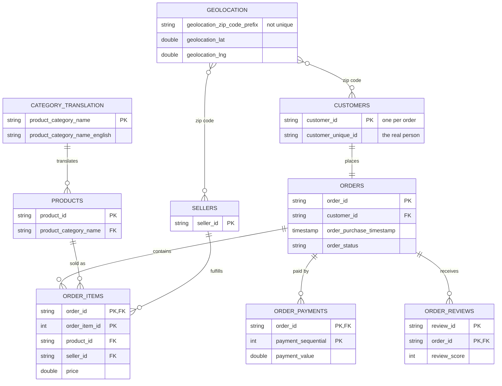

# Olist E-Commerce Analytics

End-to-end analysis of ~100k real e-commerce orders from Olist, a Brazilian marketplace (2016–2018), built on a local DuckDB warehouse.

## Business questions
1. Is the business growing, and how fast?
2. Which product categories and sellers drive revenue?
3. Do late deliveries hurt customer reviews?
4. Do customers come back and buy again?

## Data model


**Data quality findings**
- `customer_id` is generated per order. Repeat-customer analysis must use `customer_unique_id` (99,441 IDs vs. 96,096 real people).
- `review_id` alone is not unique (814 duplicates): one review can cover several orders. The true key is `review_id` + `order_id`.
- `geolocation` has many coordinate points per zip code. It must be reduced to one row per zip before joining.

## Repository structure
```
├── data/               # local only (git-ignored)
│   ├── raw/            # original Olist CSVs, never edited
│   └── olist.duckdb    # warehouse, built by load_raw.py
├── scripts/
│   ├── load_raw.py     # loads CSVs into schema `raw` (idempotent)
│   └── check_keys.py   # verifies primary keys are unique
└── requirements.txt
```

## How to reproduce
1. Clone the repo and create a Python 3.13 virtual environment
2. `pip install -r requirements.txt`
3. Download the [Olist dataset](https://www.kaggle.com/datasets/olistbr/brazilian-ecommerce) and place the 9 CSVs in `data/raw/`
4. `python scripts/load_raw.py`
5. `python scripts/check_keys.py`

## Tools
Python · DuckDB · SQL · pandas · Jupyter

## Status
🚧 In progress: data ingestion and validation complete; analysis next.

## Data source
Brazilian E-Commerce Public Dataset by Olist, via Kaggle.